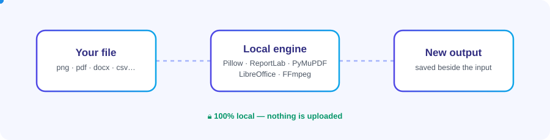

<div align="center">


**Private, local file conversion for Windows.**

Convert documents, images, PDFs, and spreadsheets without sending files to a cloud service.

</div>



## At a glance

| Files | Examples |
|---|---|
| **Images** | PNG, JPEG, WebP, BMP, TIFF, GIF, ICO |
| **Documents** | TXT, DOC, DOCX, PPTX, HTML to PDF |
| **PDFs** | PDF to DOCX or page images; merge, split, extract, rotate, optimize |
| **Spreadsheets** | XLSX to CSV and CSV to XLSX |
| **Audio and video** | Optional FFmpeg conversions when FFmpeg is installed |

The app runs conversions locally, keeps the original file, and chooses a new output name rather than overwriting an existing file. Optional conversions are shown only when their required local engine is available.

> [!NOTE]
> PDF-to-DOCX uses `pdf2docx` to reconstruct document layout. Scanned PDFs need OCR, which is not included, and complex layouts may not convert perfectly. PDF optimization performs structural cleanup; it cannot guarantee a smaller file.

## Get started

Clone the project and install its Python dependencies:

```powershell
git clone https://github.com/Aliwaris512/File-converter.git
Set-Location File-converter
py -m venv .venv
.\.venv\Scripts\python.exe -m pip install --upgrade pip
.\.venv\Scripts\python.exe -m pip install -r requirements.txt
```

Run the app:

```powershell
.\.venv\Scripts\python.exe .\app.py
```

To open a file directly in the converter:

```powershell
.\.venv\Scripts\python.exe .\app.py "C:\path with spaces\report.docx"
```

For Office document-to-PDF conversions, install LibreOffice separately. The app does not download or install conversion engines automatically.

## Windows Explorer menu

Register the per-user context menu from the project folder:

```powershell
.\scripts\install_context_menu.ps1
```

Then right-click a file and select **Convert with LocalFile Converter**. The selected file is passed directly to the popup. Unregister it with:

```powershell
.\scripts\uninstall_context_menu.ps1
```

## Build and test

Build the Windows executable:

```powershell
.\scripts\build_exe.ps1
```

Run the test suite:

```powershell
.\.venv\Scripts\python.exe -m pytest -q
```

<div align="center">

**Your files stay on your device.**

<sub><a href="readme/README.md">Full documentation</a> · <a href="THIRD_PARTY_LICENSES.md">Third-party licenses</a></sub>

</div>
